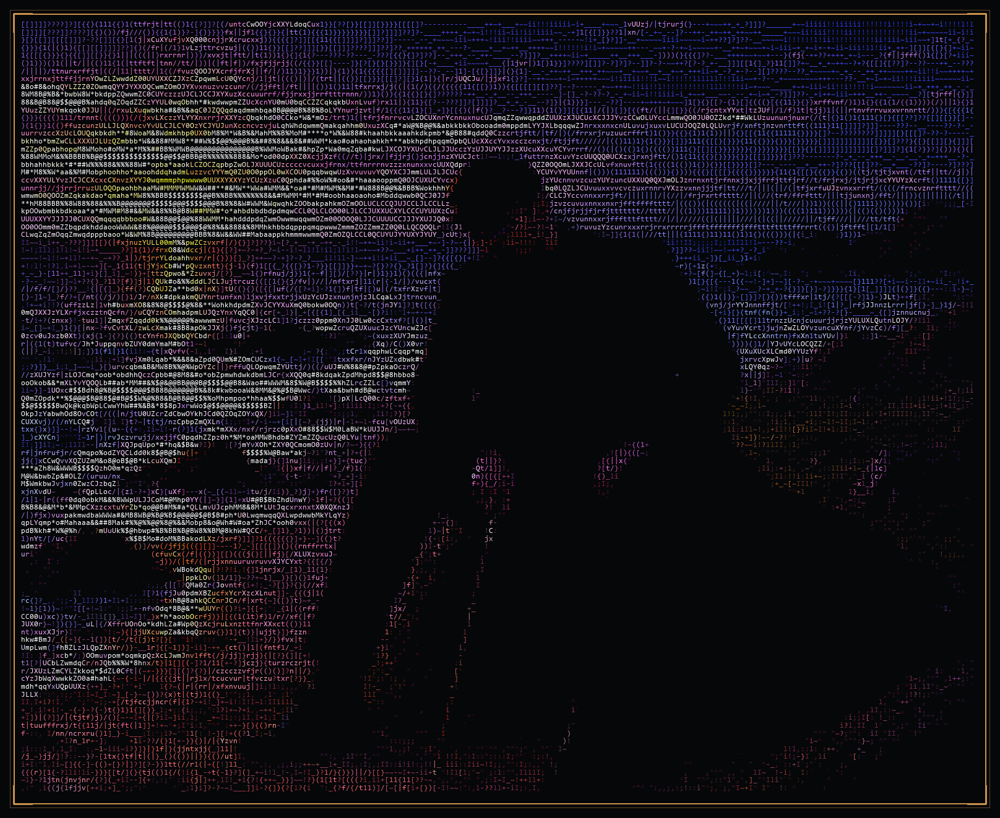

<!-- ════════════════════════════════════════════════════════ -->
<!--  Daniel Carvalho — github.com/DanielCarvalhoOut           -->
<!-- ════════════════════════════════════════════════════════ -->

<table border="0">
<tr>
<td valign="middle" width="47%">

</td>
<td valign="top" width="53%">

## Daniel Carvalho

&nbsp;

> *“Victory belongs to the most persevering.”* — Napoleon

Backend & systems engineer in the making. I build **.NET** services and
study what runs beneath them — **sockets, packets, the OS itself**.
Calm, deliberate, long game.

**▐ Arsenal**  

**▐ Infrastructure**  

**▐ Networking**  

</td>
</tr>
</table>

&nbsp;

